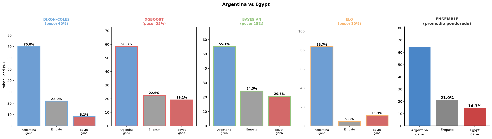
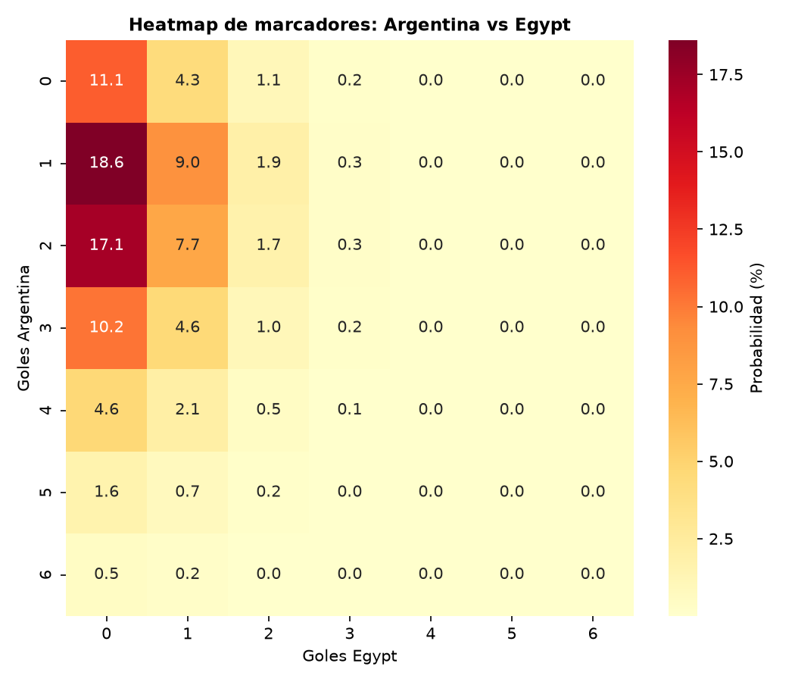
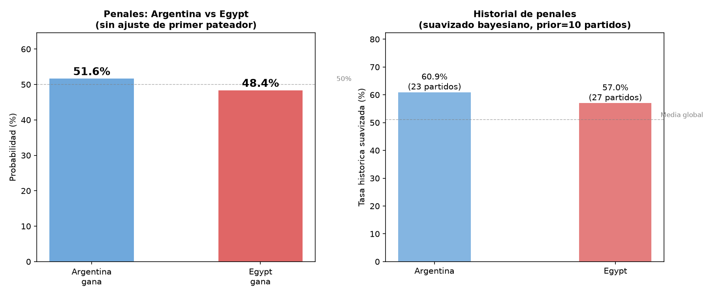

# WC2026 Match Predictor

**English** · [Español](README.es.md)

International football match prediction pipeline. Compares several model
families on the same historical dataset, combines them into an ensemble, and
estimates penalty shootouts separately.

Dataset: [international_results](https://github.com/martj42/international_results)
(martj42), 49k+ international matches since 1872, CC0.

## Models

| Model | Approach | Output |
| --- | --- | --- |
| **Dixon-Coles** | Poisson with low-score correction, fitted by MLE (`scipy.optimize`) | 1X2, top scorelines, and heatmap |
| **Bayesian** | Hierarchical Poisson fitted with MCMC (PyMC/NUTS) | 1X2 with credible intervals |
| **XGBoost** | Gradient boosting with a Poisson objective on attack/defence features | 1X2, top scorelines, and heatmap |
| **Elo** | Dynamic ratings updated match by match | 1X2 and rating difference |
| **Penalties** | Historical shootout model | Probability of winning the shootout |
| **Ensemble** | Average of the models run in the same execution | Combined 1X2 |

## Why several models instead of one

Each model represents a different family from the sports-prediction literature:
classical parametric (Dixon-Coles), Bayesian parametric (Baio-Blangiardo),
non-parametric machine learning (XGBoost), dynamic ratings (Elo), and a
dedicated knockout layer (penalties). Comparing them on the same holdout makes
it possible to discuss real trade-offs — not just "which model is better" but
"better under which metric, at what computational cost".

## Setup (macOS, with mise)

The repo includes `mise.toml` with Python 3.12 and an `.envrc` for direnv.

```bash
# 1. Clone and enter the project
git clone https://github.com/Bllq21/WC2026_Predictor.git
cd WC2026_Predictor

# 2. Trust the mise configuration and install Python
mise trust
mise install

# 3. Create the virtual environment
python3 -m venv .venv
source .venv/bin/activate

# 4. Install dependencies
pip install -r requirements.txt

# 5. Download the datasets (not in the repo because of size/freshness)
curl -sL -o results.csv \
  https://raw.githubusercontent.com/martj42/international_results/master/results.csv
curl -sL -o shootouts.csv \
  https://raw.githubusercontent.com/martj42/international_results/master/shootouts.csv
```

If you use direnv, run `direnv allow` once. The `.envrc` activates `.venv`
automatically when you enter the folder.

### Note on PyMC on Apple Silicon

PyMC uses PyTensor internally, which compiles C functions. The first run of
`model_bayesian.py` can take longer because of the initial compilation (it is
cached afterwards). If you see `gcc`/`clang` errors, install the Xcode Command
Line Tools with `xcode-select --install`.

## Usage

```bash
# Look up the exact team name (English names, no accents)
python find_team.py argentina

# Predict a match with Dixon-Coles (default)
python predict.py "Argentina" "Brazil"

# Choose a model
python predict.py "Argentina" "Austria" --model xgboost --neutral
python predict.py "Argentina" "Austria" --model bayesian --chains 4 --draws 1500
python predict.py "Argentina" "Austria" --model elo

# Run all models, save plots, and combine the ensemble
python predict.py "Argentina" "Austria" --model all --ensemble --save

# Add the penalty prediction (requires shootouts.csv)
python predict.py "Argentina" "Austria" --model all --ensemble --penalties --save

# Apply tournament weights on top of time decay
python predict.py "Argentina" "Austria" --model all --tournament-weights --ensemble

# Evaluate accuracy/RPS for Dixon-Coles and XGBoost on the last N matches
python evaluate.py 600

# Evaluate the Bayesian model (slower: retrains MCMC per match)
python evaluate_bayesian.py 20
```

**Important:** team names are in English and without accents (`Brazil`, not
`Brasil`; `Mexico`, not `México`). Use `find_team.py` if you are not sure of the
exact name.

## Visual examples

Combined prediction for Argentina vs Egypt:



Scoreline heatmap (Dixon-Coles):



Penalty shootout analysis:



The images are generated locally with `--save` and written to `outputs/`, which
is git-ignored.

## Design decisions (and their trade-offs)

- **Time-decay weighting (`half_life_days=730` by default):** the full dataset
  since 1872 is used, but old matches carry almost no weight during training.
  Without this, mixing 1930s football with current football distorts the real
  strength of teams. Adjustable via `--half-life`.

- **Optional tournament weights (`--tournament-weights`):** World Cups and
  continental tournaments weigh more than friendlies. They are applied on top
  of time decay, not instead of it.

- **Bayesian model limited to a subset of teams per match (`max_teams`,
  default 100):** NUTS with hundreds of latent parameters over 49k matches is
  slow even on powerful hardware. The universe is restricted to relevant teams
  and their direct opponents.

- **XGBoost without fine tuning:** the model runs correctly (no data leakage,
  Poisson objective, vectorised features), but the hyperparameters are a
  reasonable starting point, not the result of a grid search.

- **Elo is evaluated as a standalone model:** it uses ratings updated match by
  match and assumes a neutral venue, consistent with a World Cup.

- **Penalties as a separate layer:** the shootout is not mixed into the
  90-minute prediction. `predict.py --penalties` uses shootout history to
  estimate the winner.

- **The accuracy/RPS benchmark excludes the Bayesian model from the main
  script** (`evaluate.py`) because evaluating it on a large holdout would mean
  retraining MCMC match by match. It is evaluated separately on a smaller N in
  `evaluate_bayesian.py`.

## Structure

```text
data_prep.py          # CSV loading, time decay, and tournament weights
model_dixon_coles.py  # Poisson + MLE (scipy.optimize, analytical gradient)
model_xgboost.py      # vectorised features + XGBoost Poisson
model_bayesian.py     # hierarchical Poisson + PyMC/NUTS
model_elo.py          # Elo ratings and 1X2 prediction
model_penalties.py    # shootout history and shootout probability
visualize.py          # bars, heatmap, ensemble, and penalty analysis
predict.py            # main CLI: match, model, ensemble, and penalties
find_team.py          # exact team-name lookup
evaluate.py           # accuracy/RPS benchmark (Dixon-Coles, XGBoost)
evaluate_bayesian.py  # accuracy/RPS benchmark (Bayesian, small N)
docs/                 # example plots
outputs/              # plots generated with --save (git-ignored)
```

## Metrics

- **1X2 accuracy:** % of matches where the predicted most likely outcome
  (home win / draw / away win) matched the actual result.
- **RPS (Rank Probability Score):** a more informative metric than accuracy for
  ordinal outcomes — it penalises predicting "draw" when the home team won less
  than predicting "away win" when the home team actually won. Lower is better.

## Next steps

- Tune XGBoost hyperparameters (grid search or Optuna).
- Calibrate probabilities (Platt scaling / isotonic regression).
- Add Elo as an additional XGBoost feature.
- Raise the Bayesian model's `max_teams` by using more cores.
- Add an exploratory notebook once the codebase stabilises.

## Troubleshooting

- **`results.csv` is missing:** download both CSV files with the setup
  commands above.
- **PyMC build errors on macOS:** run `xcode-select --install` and retry.
- **A team is not found:** use `python find_team.py <name>`. Team names are in
  English and without accents.

## License

MIT — see [LICENSE](LICENSE).
